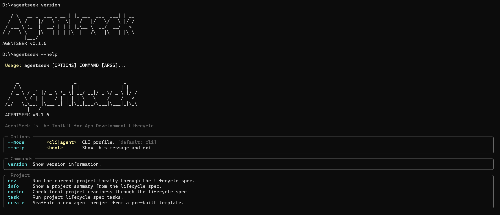
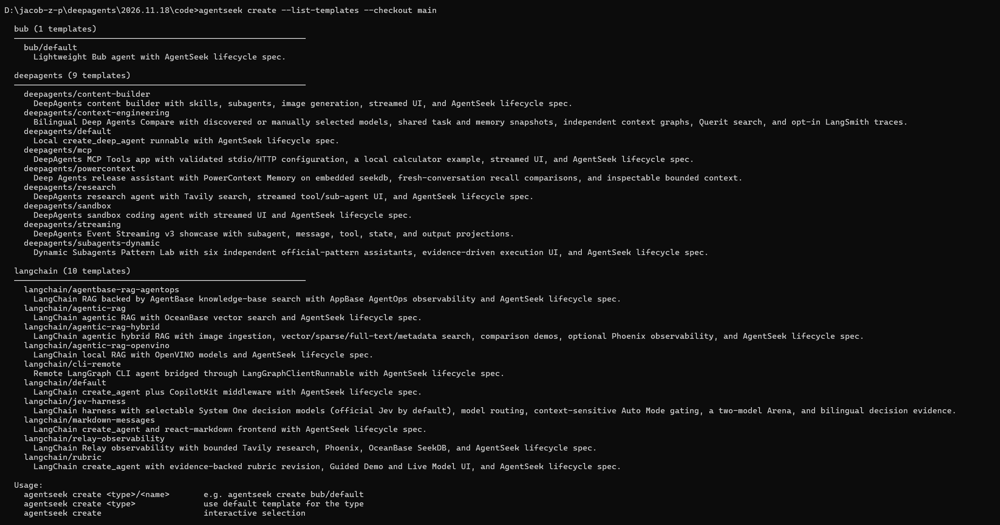
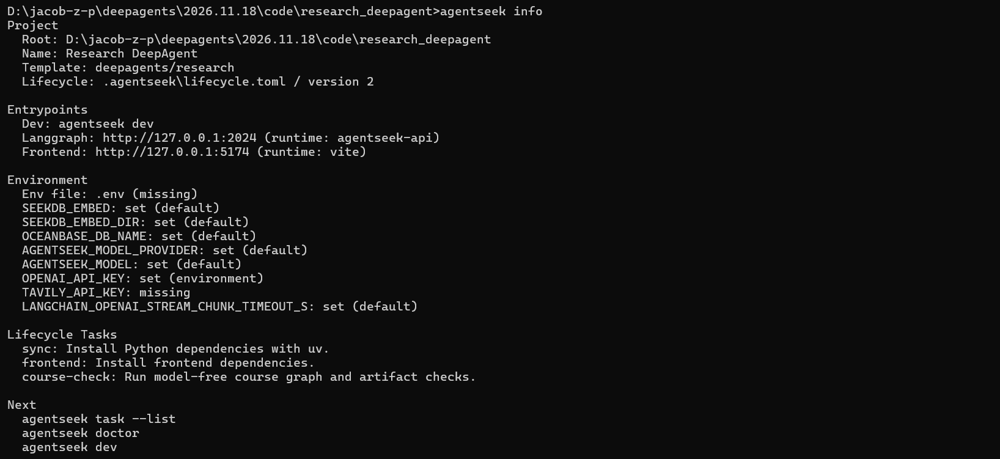
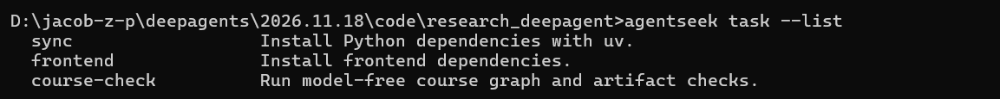
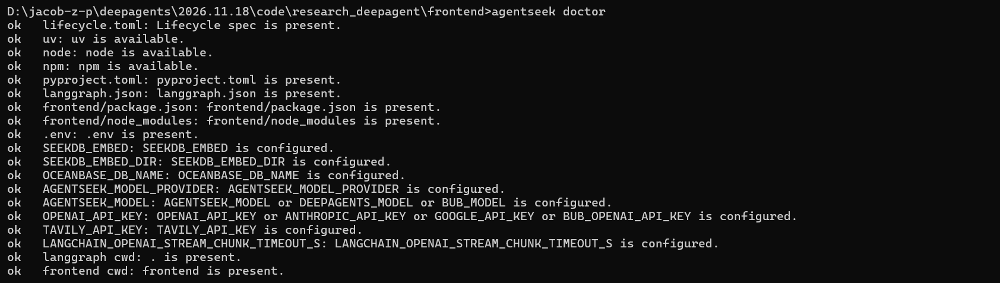
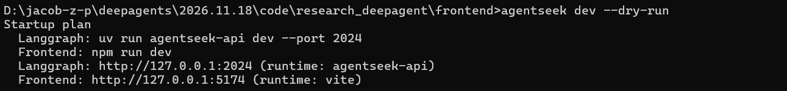
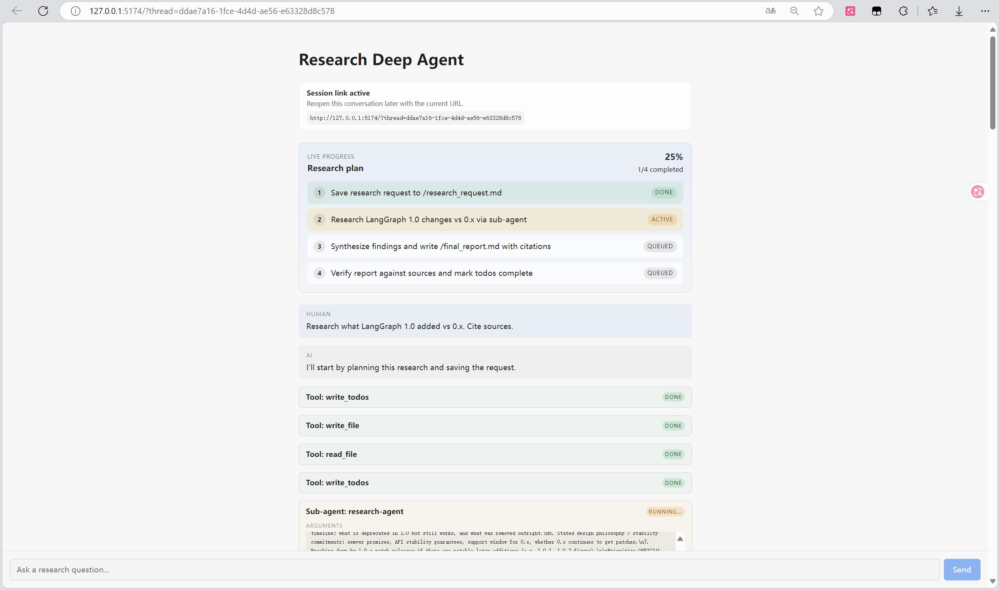

# 准备篇

通过 `uv` 包管理器安装 `agentseek`

```bash
uv tool install --upgrade agentseek
```

`uv tool install` 把可执行文件放在了 `C:\Users\#{用户名}\.local\bin`。系统执行命令时，只会搜索 `PATH` 里列出的目录，所以要把这个目录放到用户环境变量里。执行下面的命令：

```
uv tool update-shell
```

然后确认命令可用：

```
agentseek version
sgent --help
```



可以通过一个命令查看 `main` 分支当前注册的模板：

```
agentseek create --list-templates --checkout main
```



创建 `deepagents/research` 项目并从模板仓库的 `main` 分支获取最新批次模板：

```
agentseek create deepagents/research --checkout main --no-input
```

进入生成目录：

```
cd research_deepagent
```

查看项目摘要：

```
agentseek info
```



查看模板提供的任务：

```
agentseek task --list
```



接下来安装项目依赖：

```
# 后端依赖
agentseek task sync
# 前端依赖
agentseek task frontend
```

接下来就是配置模型了。

首先复制后端和前端环境：

```
cp .env.example .env
cp frontend/.env.example frontend/.env
```

在 .env 中配置好对应的 API KEY。注意真实 KEY 不要提交到 Git 上，不然可能钱就要归零喽！

我是在 windows 中运行的，所以数据库改为了 `SQLite`：

```
METADATA_DB_BACKEND=sqlite
METADATA_DB_URL=sqlite:///D:/jacob-z-p/deepagents/2026.11.18/code/research_deepagent/.agentseek/metadata.db
```

接着进行运行前的就绪检查：

```
agentseek doctor
```



然后预览开发进程，不启动服务：

```
agentseek dev --dry-run
```



启动前后端进程：

```
agentseek dev
```

保持这个终端运行。在另一个终端中进入同一项目目录，检查两个服务：

```
agentseek doctor --live
```

打开 `http://127.0.0.1:5174`，输入：

```
Research what LangGraph 1.0 added vs 0.x. Cite sources.
```

以下是部分的思考过程：



结束。。。